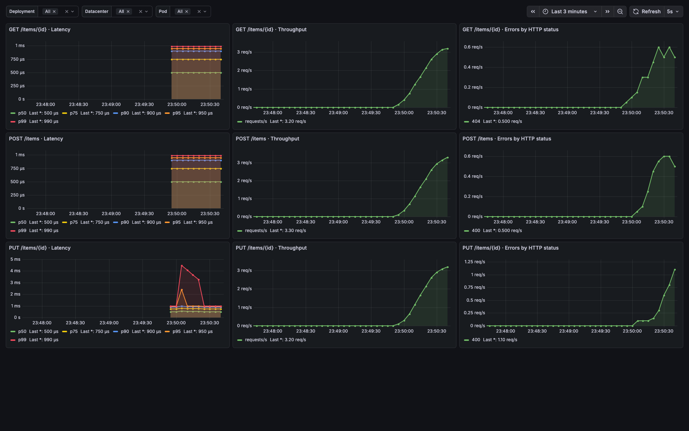

# HW1: Grafana

Запуск из этой папки:

```sh
docker compose up --build -d
```

Дашборд: http://localhost:3000/d/ddia-hw-1 (просмотр без входа).
Нагрузка растёт до 10 запросов/с за 30 секунд и работает 5 минут.
Примерно 20% запросов возвращают 400/404. Графики появляются после первых scrape.

```sh
docker compose restart load
docker compose run --rm generate
docker compose down
```

Приложение: `http://localhost:8080`. Ручки: `GET /items/{id}`, `POST /items`,
`PUT /items/{id}`; тело POST/PUT: `{"name":"example"}`. Объект `1` существует при старте.
Данные хранятся в памяти. `/metrics` экспортирует метрики, `/endpoints` список ручек.

`DEPLOYMENT`, `DATACENTER`, `POD` задаются в Compose. Дашборд содержит RPS,
ошибки по HTTP-коду и p50/p75/p90/p95/p99, селекторы датацентра/пода; редактирование выключено.
Генератор получает ручки в runtime и использует HTTP API Grafana без SDK.

Пароль Grafana и Service Account Token создаются автоматически и хранятся в отдельных
Docker volumes. Генератор получает только токен. Метрики сохраняются в volume `metrics-data`.
`docker compose down` сохраняет volumes.

Версии: Go 1.26.1, Prometheus client 1.23.2, Grafana 12.3.6, VictoriaMetrics 1.136.0.


